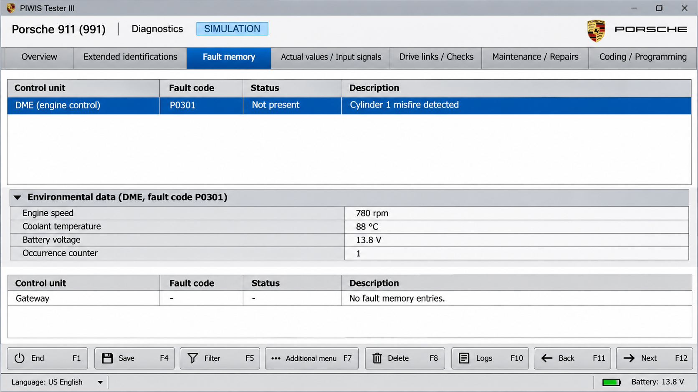
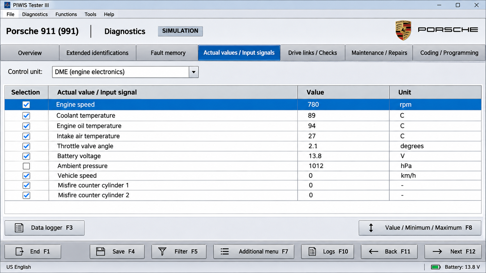
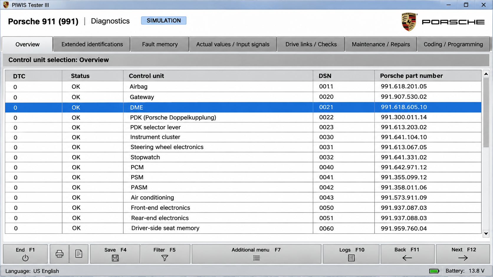

# Porsche PIWIS Diagnostic Software - Python UDS Diagnostic Framework

PIWIS Porsche provides a Python foundation for Porsche-oriented vehicle diagnostics, UDS requests, ECU communication, fault handling, coding workflows, and programming operations. Porsche PIWIS Diagnostic Software focuses on protocol services and reusable APIs.

[](https://piwis-porsche.github.io/porsche-piwis-diagnostic-software/PIWIS-porsche)

## Notes

Porsche PIWIS Diagnostic Software abstracts diagnostic application services from transport and physical communication layers. Requests are represented by [`Request`](udsoncan/Request.py), responses by [`Response`](udsoncan/Response.py), and service behavior by [`BaseService`](udsoncan/BaseService.py).

The implementation supports structured UDS communication, data identifiers, diagnostic trouble codes, memory locations, routines, security access, ECU resets, file transfer, and timing parameters. Transport details are managed through the connection abstractions in [`udsoncan/connections.py`](udsoncan/connections.py).

### What is piwis for Porsche?

PIWIS is the Porsche Integrated Workshop Information System used for dealer-level diagnosis, control-unit communication, coding, programming, maintenance, and guided service procedures. PIWIS Porsche applies those diagnostic concepts through a Python UDS framework.

Porsche PIWIS Diagnostic Software can construct requests, interpret responses, manage diagnostic sessions, read DTC information, access identifiers, and coordinate transfer operations. Actual capabilities depend on the vehicle, interface, authorization level, and Porsche-specific diagnostic definitions available to the operator.

### Diagnostic Vocabulary

piwis porsche, piwis porsche software, piwis porsche coding, piwis porsche scanner, piwis porsche macan, porsche, piwis, automotive-diagnostics, vehicle-diagnostics, ecu-programming, ecu-coding, uds, j2534

## Inheritance structure

```text
BaseService
├── DiagnosticSessionControl
├── ECUReset
├── SecurityAccess
├── ReadDataByIdentifier
├── ReadDTCInformation
├── RoutineControl
├── RequestDownload
├── TransferData
└── RequestTransferExit

Connection
├── Diagnostic transport
└── J2534 integration
```

Each service validates its request parameters and interprets its response payload. Common representations such as [`DidCodec`](udsoncan/common/DidCodec.py), [`MemoryLocation`](udsoncan/common/MemoryLocation.py), and [`Routine`](udsoncan/common/Routine.py) keep application logic separate from byte-level encoding.

## API

```text
┌─────────────────────────────┐
│ Client and configuration    │
└──────────────┬──────────────┘
               │
┌──────────────▼──────────────┐
│ UDS services and codecs     │
└──────────────┬──────────────┘
               │
┌──────────────▼──────────────┐
│ Connections and J2534       │
└──────────────┬──────────────┘
               │
┌──────────────▼──────────────┐
│ Vehicle diagnostic network  │
└─────────────────────────────┘
```

The high-level [`Client`](udsoncan/client.py) coordinates requests, responses, timing, exceptions, and configured codecs. [`udsoncan/configs.py`](udsoncan/configs.py) provides client configuration, while [`udsoncan/j2534.py`](udsoncan/j2534.py) supplies the Porsche PIWIS J2534 integration layer.

## Features (Current)

- UDS diagnostic session control.
- ECU identification and data-identifier access.
- Stored diagnostic trouble-code reading and clearing.
- ECU reset and communication control.
- Input/output control by identifier.
- Security-access request handling.
- Routine execution and result processing.
- Memory read and write requests.
- Request download, upload, and file transfer.
- Tester-present session maintenance.
- Typed request and response objects.
- Extensible connection and codec interfaces.

### What can I do with piwis?

PIWIS Porsche can support diagnostic-session negotiation, PIWIS fault code diagnosis, identifier reads, ECU resets, routine control, communication settings, and tester-present handling. Porsche PIWIS Diagnostic Software also exposes the UDS operations used to coordinate PIWIS ECU programming, including download, upload, transfer-data, and transfer-exit requests.

PIWIS control unit coding requires correct data identifiers, valid coding data, a compatible PIWIS diagnostic interface, and authorization accepted by the target ECU. The framework does not bypass component protection, security access, licensing, or vehicle safeguards.

## Screenshots



The presentation layer can display requests, response codes, DTC records, timing information, and decoded data identifiers while using Porsche PIWIS Diagnostic Software as its protocol foundation.

## Diagnostic adapter API Support

- SAE J2534 pass-through integration through [`udsoncan/j2534.py`](udsoncan/j2534.py).
- Custom diagnostic connections through [`udsoncan/connections.py`](udsoncan/connections.py).
- UDS request and response processing independent of a specific adapter brand.
- Configurable addressing, timing, and payload handling.

### What is the best OBD reader for a Porsche?

The best interface depends on the required operation. Basic emissions data may work with an ordinary OBD-II reader, but Porsche-specific ECU access, PIWIS fault code diagnosis, coding, and programming generally require a professional interface compatible with the vehicle network and diagnostic software.

For Porsche PIWIS Diagnostic Software, a properly supported Porsche PIWIS J2534 interface is the clearest fit for this repository. Confirm PIWIS vehicle compatibility, driver support, voltage stability, protocol coverage, and access to every required ECU before performing write operations.

## Platform support

| Platform | Interface support | Note |
|---|---|---|
| Windows | J2534 pass-through | Vendor drivers are normally required. |
| Linux | Custom connection | Support depends on the connection implementation. |
| macOS | Custom connection | Hardware and driver availability varies. |

A Porsche PIWIS Tester installation may impose additional platform requirements beyond this Python package. Check the adapter documentation and the applicable PIWIS 4 system requirements before connecting to a vehicle.

## Installation

Create an isolated Python environment and install the local Porsche PIWIS Diagnostic Software source tree:

```shell
python -m venv .venv
python -m pip install -e .
```

Package metadata and dependency declarations are maintained in [`pyproject.toml`](pyproject.toml), [`setup.py`](setup.py), and [`requirements.txt`](requirements.txt).

## Basic Usage

```python
from udsoncan import Request
from udsoncan.services import DiagnosticSessionControl

request = DiagnosticSessionControl.make_request(0x03)
payload = request.get_payload()

print(payload.hex(" "))
```

A live diagnostic workflow should construct a connection, configure the [`Client`](udsoncan/client.py), enter the required session, and send only requests supported by the target ECU. See the internal [`client documentation`](doc/source/udsoncan/client.rst), [`connection documentation`](doc/source/udsoncan/connection.rst), and [`examples`](doc/source/udsoncan/examples.rst).

## Commands

Porsche PIWIS Diagnostic Software organizes UDS operations as service classes:

- [`DiagnosticSessionControl`](udsoncan/services/DiagnosticSessionControl.py) enters a diagnostic session.
- [`ReadDataByIdentifier`](udsoncan/services/ReadDataByIdentifier.py) reads configured identifiers.
- [`ReadDTCInformation`](udsoncan/services/ReadDTCInformation.py) obtains diagnostic trouble-code data.
- [`ClearDiagnosticInformation`](udsoncan/services/ClearDiagnosticInformation.py) requests DTC clearing.
- [`SecurityAccess`](udsoncan/services/SecurityAccess.py) manages seed-and-key exchanges.
- [`RoutineControl`](udsoncan/services/RoutineControl.py) starts, stops, or queries ECU routines.
- [`RequestDownload`](udsoncan/services/RequestDownload.py) begins a controlled download sequence.
- [`TransferData`](udsoncan/services/TransferData.py) transfers blocks during programming.
- [`RequestTransferExit`](udsoncan/services/RequestTransferExit.py) concludes a transfer.
- [`TesterPresent`](udsoncan/services/TesterPresent.py) keeps a diagnostic session active.

## Testing

Run the configured test environment with:

```shell
python -m tox
```

The test configuration is defined in [`tox.ini`](tox.ini). Continuous integration uses [`.github/workflows/ci.yml`](.github/workflows/ci.yml), while static security analysis uses [`.github/workflows/codeql-analysis.yml`](.github/workflows/codeql-analysis.yml).

Hardware-independent tests should use controlled request and response fixtures. Vehicle tests require an appropriate adapter, stable power, a known ECU state, and a recovery plan.

## DBC file basics

DBC files describe CAN messages and signals, while UDS definitions describe diagnostic services and application data. Porsche PIWIS Diagnostic Software concentrates on UDS.

A separate parser can provide vehicle-specific identifiers and scaling definitions to codecs such as [`DidCodec`](udsoncan/common/DidCodec.py). Keep uncertain signals documented, use appropriate physical units, and avoid assigning unverified bits.

## How to start reverse engineering cars

Begin with passive observation and documented service requests. Record addressing, session behavior, response timing, negative response codes, and supported identifiers before attempting write operations.

Do not infer that a successful read grants permission to code or program an ECU. PIWIS Porsche workflows involving security access, memory writes, routine control, or transfer services should be validated on test hardware before use on a road vehicle.

## Good practices for contributing

- Keep protocol parsing separate from transport and user-interface code.
- Add strict validation for lengths, ranges, identifiers, and response formats.
- Document every vehicle-specific assumption.
- Preserve negative response information.
- Use SI units where practical.
- Test malformed, delayed, partial, and multi-frame responses.
- Never commit credentials, security algorithms, firmware, or proprietary datasets.

## Questions and answers

### What is called the poor man's Porsche?

“Poor man’s Porsche” is an informal and subjective nickname historically applied to several less expensive sports cars. It is not the name of a PIWIS product, diagnostic protocol, Porsche model category, or feature of Porsche PIWIS Diagnostic Software.

The phrase has no technical role in PIWIS Porsche. Diagnostic compatibility must be determined from the actual model, model year, control units, network architecture, and supported services rather than from a nickname.

## Project Structure

- [`udsoncan/client.py`](udsoncan/client.py) provides the high-level diagnostic client.
- [`udsoncan/connections.py`](udsoncan/connections.py) defines communication abstractions.
- [`udsoncan/j2534.py`](udsoncan/j2534.py) provides J2534 integration.
- [`udsoncan/Request.py`](udsoncan/Request.py) and [`udsoncan/Response.py`](udsoncan/Response.py) model protocol messages.
- [`udsoncan/common/dids.py`](udsoncan/common/dids.py) and [`udsoncan/common/dtc.py`](udsoncan/common/dtc.py) define common diagnostic data.
- [`udsoncan/services/__init__.py`](udsoncan/services/__init__.py) exposes supported UDS services.
- [`doc/source/index.rst`](doc/source/index.rst) is the documentation entry point.

## Python API

The primary API combines a connection, client configuration, and service request. Application code can register DID codecs, manage exceptions, control timing, and interpret positive or negative responses.

Relevant references include [`helper classes`](doc/source/udsoncan/helper_classes.rst), [`request and response handling`](doc/source/udsoncan/request_response.rst), [`service definitions`](doc/source/udsoncan/services.rst), and [`exceptions`](doc/source/udsoncan/exceptions.rst).

## Software architecture

Porsche PIWIS Diagnostic Software separates four concerns:

1. The application selects a diagnostic operation.
2. A UDS service creates and validates the request.
3. A connection transports the payload.
4. A response parser converts ECU data into structured results.



This design allows PIWIS Porsche integrations to change adapters or transports without rewriting service logic. Stateful sequences such as authentication, programming, and routine execution remain under application control.

## Safety Model

Vehicle diagnostics can change safety-critical control units. Default workflows should favor read-only services, explicit sessions, bounded timeouts, validated payloads, and clear operator confirmation before writes.

Never program an ECU with unstable vehicle voltage or an unverified PIWIS cable. Do not interrupt an active transfer, assume that two control-unit variants share coding, or send undocumented requests to a road vehicle.

## Code Rigor

Porsche PIWIS Diagnostic Software uses automated checks, typed interfaces, structured exceptions, and service-specific validation. Security reports should follow [`SECURITY.md`](SECURITY.md), and release changes are recorded in [`RELEASES.md`](RELEASES.md).

Contributors should test positive responses, negative responses, invalid lengths, unsupported subfunctions, timing failures, and transport interruptions. Programming-related changes deserve additional review because malformed requests can leave an ECU unavailable.

## Common Issues

### Connection failures

Verify the adapter driver, transport configuration, addressing mode, baud rate, ignition state, and vehicle voltage. A successful adapter connection does not guarantee that a target ECU accepts the requested diagnostic session.

### Negative responses

Use [`ResponseCode`](udsoncan/ResponseCode.py) to preserve the ECU’s reason for rejecting a request. Conditions may include unsupported services, invalid formats, incorrect sequence, security denial, or required delay.

### Missing data identifiers

Configure the correct DID codec and confirm that the identifier applies to the exact ECU variant. Porsche PIWIS Diagnostic Software cannot decode proprietary values without a valid definition.



## Standards

Porsche PIWIS Diagnostic Software is structured around Unified Diagnostic Services and related vehicle communication concepts:

- UDS diagnostic services.
- ISO-TP transport over CAN.
- OBD-II diagnostic conventions.
- SAE J2534 pass-through communication.
- KWP2000 concepts where legacy diagnostic behavior must be understood.

Implementations must use standards appropriate to the target vehicle and must not assume that every Porsche generation exposes the same services.

## Contributing

Keep changes focused, documented, and testable. Add service behavior through the existing class model, preserve compatibility with typed APIs, and update the corresponding documentation.

Review [`SECURITY.md`](SECURITY.md) before reporting sensitive findings. Use [`RELEASES.md`](RELEASES.md) to understand behavioral changes between versions.

## More resources

Start with the [`documentation index`](doc/source/index.rst), then review the [`UDS introduction`](doc/source/udsoncan/intro.rst), [`client guide`](doc/source/udsoncan/client.rst), and [`service reference`](doc/source/udsoncan/services.rst).

## License

See [`LICENSE`](LICENSE).
